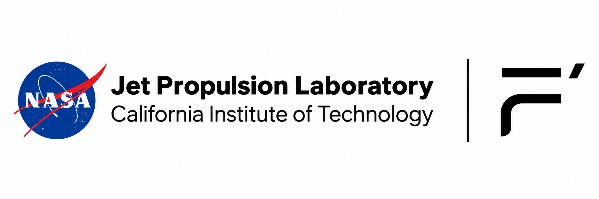

# Sreehari S J

**AI/ML Engineer &nbsp;·&nbsp; India Book of Records Achiever &nbsp;·&nbsp; Research @ IISER Bhopal**

  
  
  
  
  
  
  

---

## About

<table>
<tr>
<td width="50%" valign="top">

CS undergrad focused on turning AI research into practical, deployed systems. 
**Open to** Research · Internships · Open-Source Collaboration

</td>
<td width="50%" valign="top">

**Based in** Kerala, India 
**Studying** CS @ Marian Engineering College 
**Focus** Signal Processing · Deep Learning · Multi-Agent Systems 

</td>
</tr>
</table>

## Highlights

<table>
<tr>
<td width="33%" valign="top">

 
**India Book of Records** 
Record holder

Camera-free gesture recognition using only Wi-Fi signals: 90.2% accuracy, no cameras, no wearables.

`Wi-Fi CSI` `ESP32` `Deep Learning`

</td>
<td width="33%" valign="top">

 
**Research Assistant** 
IISER Bhopal

Independent research on telecom fraud detection under Prof. Vinod K. Kurmi.

`Machine Learning` `Fraud Detection` `Research`

</td>
<td width="33%" valign="top">

 
**Flight Software Intern** 
HEX20

Building flight software as an intern.

`Flight Software` `Embedded`

</td>
</tr>
</table>

---

## Tech Stack

<table>
<tr>
<td width="50%" valign="top">

**AI / ML**  
 
LangChain · Matplotlib · NLP · Computer Vision

</td>
<td width="50%" valign="top">

**Web & Backend**  

</td>
</tr>
<tr>
<td width="50%" valign="top">

**Tools & Infra**  

</td>
<td width="50%" valign="top">

**Signals & Embedded**  
Signal Processing · Wi-Fi CSI · RF presence detection · ESP32 · Sensor fusion

</td>
</tr>
</table>

---

## Open Source Contributions

<!-- PRS:START -->
| | Pull request | Repository | Merged |
| --- | --- | --- | --- |
|  | [Svc/RateGroupDriver: compute rollover using LCM instead of product (#5987)](https://github.com/nasa/fprime/pull/6037) |  | 2026-10-28 |
|  | [Svc/CmdSequencer: reject invalid time-tag microseconds and zero-record AMPCS files (#5891)](https://github.com/nasa/fprime/pull/6039) |  | 2026-09-28 |
|  | [cmake/API.cmake: fix SOURCES typo in register_fprime_config STATIC check](https://github.com/nasa/fprime/pull/6022) |  | 2026-09-22 |
|  | [Ref/DpDemo: use FPP default priority when command priority is 0](https://github.com/nasa/fprime/pull/6003) |  | 2026-09-21 |
|  | [MpcController: fix typos in untilted body velocity error and vertical acceleration constraint](https://github.com/ctu-mrs/mrs_uav_controllers/pull/12) |  | 2026-09-17 |
|  | [Add neural factorization autoencoder modules and preprocessing](https://github.com/DeveloperAromal/Fraud_Detection_FFNN/pull/1) | DeveloperAromal/Fraud_Detection_FFNN | 2026-01-22 |
|  | [Update layout problems, add loading component, and included a placeholder favicon image](https://github.com/Laut-org/Laut-web/pull/1) | Laut-org/Laut-web | 2025-08-21 |
|  | [fix bug](https://github.com/Xer0oo7/Begin2Build/pull/2) | Xer0oo7/Begin2Build | 2025-06-26 |
<!-- PRS:END -->

<a href="https://github.com/pulls?q=is%3Apr+author%3Asjsreehari+is%3Amerged+is%3Apublic">View all →</a>

